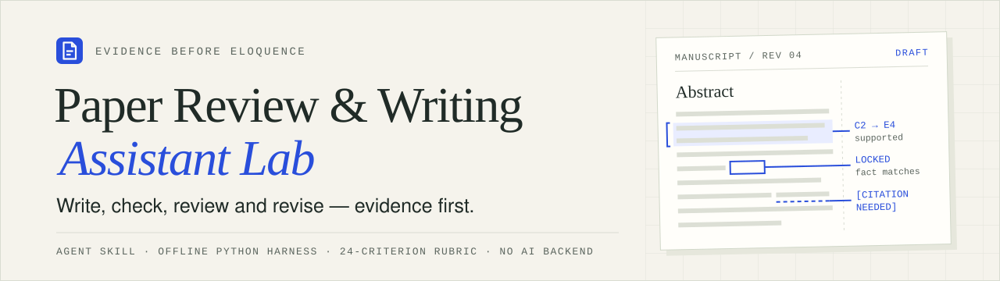
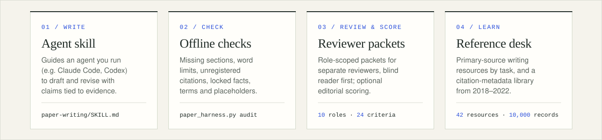
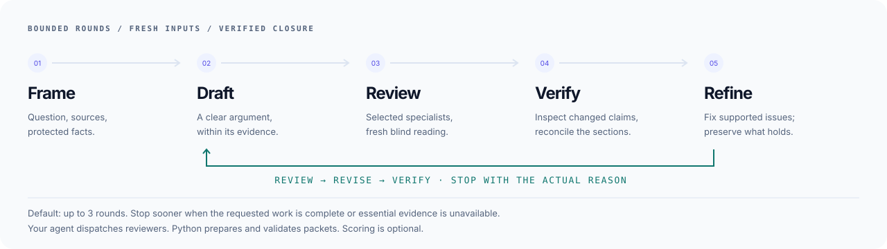

<picture>
  <source media="(prefers-color-scheme: dark)" srcset=".github/assets/banner-dark.svg">
  
</picture>

<p align="center">
  <a href="https://optimizer077.github.io/paper-review-lab/"></a>
  <a href="toolkit/paper-writing/references/iterative-review.md"></a>
  
  <a href="#verification"></a>
</p>

<p align="center">
  <a href="https://optimizer077.github.io/paper-review-lab/writing.html"><b>Start writing</b></a> ·
  <a href="toolkit/paper-writing/SKILL.md"><b>Read the skill</b></a> ·
  <a href="https://optimizer077.github.io/paper-review-lab/downloads/paper-review-lab.zip"><b>Download the toolkit</b></a> ·
  <a href="https://optimizer077.github.io/paper-review-lab/resources.html"><b>Writing resources</b></a>
</p>

Scientific writing improves when the argument, evidence and reader's understanding stay connected. **Paper Review & Writing Lab** brings them into one inspectable revision workflow: an agent skill for drafting, independent reviewers for testing the argument, and offline tools for checking what changed.

Designed for **machine learning, computer vision and health research**. Use the skill in the agent you already operate; open the browser workbench when an evidence-backed editorial assessment would help.

## A complete revision workflow

<picture>
  <source media="(prefers-color-scheme: dark)" srcset=".github/assets/capabilities-dark.svg">
  
</picture>

| Work | What you get | Guide |
| --- | --- | --- |
| **Draft and revise** | Clear abstracts, introductions and manuscript sections that preserve results, terminology and scientific scope. | [Paper-writing skill](toolkit/paper-writing/SKILL.md) |
| **Coordinate reviewers** | A flexible team from ten bundled roles or your own specialists, with fresh blind reading and a single manuscript editor. | [Iterative review](toolkit/paper-writing/references/iterative-review.md) |
| **Check the revision** | Offline checks for configured facts, citations, terminology and unresolved markers; reports tied to the manuscript and context hashes. | [Harness commands](toolkit/paper-writing/references/harness-guide.md) |
| **Assess when useful** | Optional scoring across 24 anchored criteria, five domains and four contribution profiles, with coverage and blockers visible. | [Review workbench](https://optimizer077.github.io/paper-review-lab/#workbench) |

## Start with one real writing task

Clone this repository or download the [portable toolkit](https://optimizer077.github.io/paper-review-lab/downloads/paper-review-lab.zip). The skill is `toolkit/paper-writing` in the repository and `paper-review-lab/paper-writing` in the ZIP. Keep its `SKILL.md`, `references/`, `assets/` and `scripts/` together.

Ask your agent:

```text
Use $paper-writing at toolkit/paper-writing/SKILL.md.

Improve the abstract and introduction of my manuscript against the supplied
experiment records. Use independent argument, evidence and blind-reader reviews,
with at most three rounds. Preserve the actual results and scientific scope.

Return the revised sections, the consequential changes, unresolved evidence
and the reason you stopped. No score is needed.
```

For a short edit, the skill can use compact notes and relevant checks. For a larger project, keep an [iteration state](toolkit/paper-writing/assets/iteration-state-template.json) and [revision ledger](toolkit/paper-writing/assets/revision-ledger-template.json). The [writing guide](https://optimizer077.github.io/paper-review-lab/writing.html) has installation instructions and prompts for section edits, evidence checks and reviewer responses.

## An iterative loop with a stopping point

<picture>
  <source media="(prefers-color-scheme: dark)" srcset=".github/assets/workflow-dark.svg">
  
</picture>

1. **Freeze the inputs.** Identify the requested scope, manuscript, evidence and protected facts.
2. **Invite independent perspectives.** Choose useful reviewers and run them in waves within the agent runtime's capacity. A blind reader saves its first interpretation before seeing author intent or other reviews.
3. **Adjudicate and revise.** Inspect the cited evidence, consolidate repeated findings and let one editor apply supported changes.
4. **Verify the changed artifact.** Reconcile dependent sections and obtain fresh reports for affected claims. Old hashes stay attached to old reviews.
5. **Stop honestly.** Default to at most three rounds, with an earlier stop when the requested work is complete, essential evidence is unavailable, or two consecutive rounds make no substantive progress. A round limit is recorded as a limit.

The agent runtime launches reviewers. The Python harness prepares packets and validates returned reports; a generated packet is still a task awaiting a review. Scoring remains optional throughout.

<details>
<summary><b>Try the offline harness</b></summary>

From the repository root, with Python 3.10+:

```sh
# Audit the explicitly fictional example.
python toolkit/paper-writing/scripts/paper_harness.py audit toolkit/examples/manuscript.md --context toolkit/examples/project.json --out audit.json

# Select a focused team. Omit --select-roles for all ten bundled roles.
python toolkit/paper-writing/scripts/paper_harness.py plan toolkit/examples/manuscript.md --context toolkit/examples/project.json --select-roles argument,evidence,readability --out review/round-01/plan.json

# After actual reviewers return their reports, merge every selected role.
python toolkit/paper-writing/scripts/paper_harness.py merge review/round-01/plan.json review/round-01/argument-review.json review/round-01/evidence-review.json review/round-01/readability-review.json --out review/round-01/merged.json
```

Use `--roles custom-roles.json` for your own nonempty role catalog. Packets contain report field definitions, checks and verdict rules. Missing, stale, malformed or unexpected reports prevent a passing merge. A scoped review remains scoped.

For your paper, replace the example with the real manuscript and an adapted [project context](toolkit/paper-writing/assets/project-template.json). These tools use Python's standard library and make no model calls. Optional corpus collectors have separate dependencies and run only when invoked.

</details>

## Explore the workbench and reference desk

Serve the buildless site locally:

```sh
python -m http.server 8765 --directory docs
```

Open `http://localhost:8765`.

- **[Review workbench](https://optimizer077.github.io/paper-review-lab/#workbench):** record inspected evidence, ratings, confidence and blockers. Export JSON before closing the tab; entries are not saved automatically.
- **[Writing resources](https://optimizer077.github.io/paper-review-lab/resources.html):** 42 selected primary-source guides, manuals, courses, reporting standards and documented tools, organized by the next writing task.
- **[Historical library](https://optimizer077.github.io/paper-review-lab/#library):** 10,000 citation-metadata records from 2018–2022, with links to original sources. The collection contains 9,000 conference and 1,000 journal records; metadata collection adds no new reading claims.

Four contribution profiles cover empirical ML, theory, clinical research and systematic reviews. The optional [scoring policy](toolkit/paper-writing/references/aggressive-review.md) reports raw and capped totals separately. Its thresholds are editorial conventions without prospective real-manuscript calibration.

## Verification

```sh
python -m unittest discover -s toolkit/validation -p 'test_*.py' -q
python tests/check_site_parity.py
python toolkit/paper-writing/scripts/validate_writing_resources.py toolkit/paper-writing/references/writing-resources.json
```

| Check | Recorded local result |
| --- | --- |
| Portable toolkit | **135 tests: 134 passed, 1 private-cache check skipped** |
| Browser/Python scorer parity | **176 synthetic scenarios, zero mismatches** across four profiles and two policies |
| Writing-resource catalog | **42 resources across eight categories**, validated |
| Iterative harness | Focused and custom teams, blind packet separation, missing reviewers and stale-round rejection covered by behavioral tests |

The parity check requires Node.js 20+ alongside Python. Badges record local checks. Synthetic fixtures exercise software behavior; they are not real-paper evaluations or a calibrated measure of scientific quality.

## Evidence and access

**Scientific claims stay tied to inspected evidence.** An audit pass, source ID, declared claim status or completed review does not establish truth, originality or submission readiness. Numeric associations and TeX parsing are heuristic; inspect alerts in context.

**The site is a local browser workbench.** It does not read manuscripts or call an AI service. The skill runs inside your agent, which uses its configured model provider. The site loads no external scripts; Google Fonts are optional external style resources with local font fallbacks.

**The historical collection is metadata only.** No article abstracts or bodies are distributed here. Eighteen selected papers were inspected at abstract or selected-section level in the original collection. This is a selected reference library, not a systematic search or 10,000 scientific reviews. Writing-support resources have their own dated inspection records and may postdate 2022.

## Inside the repository

```text
docs/                 Buildless website, browser scorer and toolkit download
toolkit/paper-writing/ Agent skill, references, templates and offline scripts
toolkit/examples/      Explicitly fictional software fixtures
toolkit/research/      Citation metadata and bounded inspection notes
toolkit/validation/    Portable regression tests
tests/                Browser/Python scoring parity
.github/assets/       Theme-aware identity and workflow graphics
```

[Toolkit guide](toolkit/README.md) · [Review protocol](toolkit/paper-writing/references/review-protocol.md) · [Site maintenance](docs/README.md)

## License

No license file is published; default copyright applies. Ask the repository owner before reusing code or text. Third-party guides, standards and papers retain their own terms.
