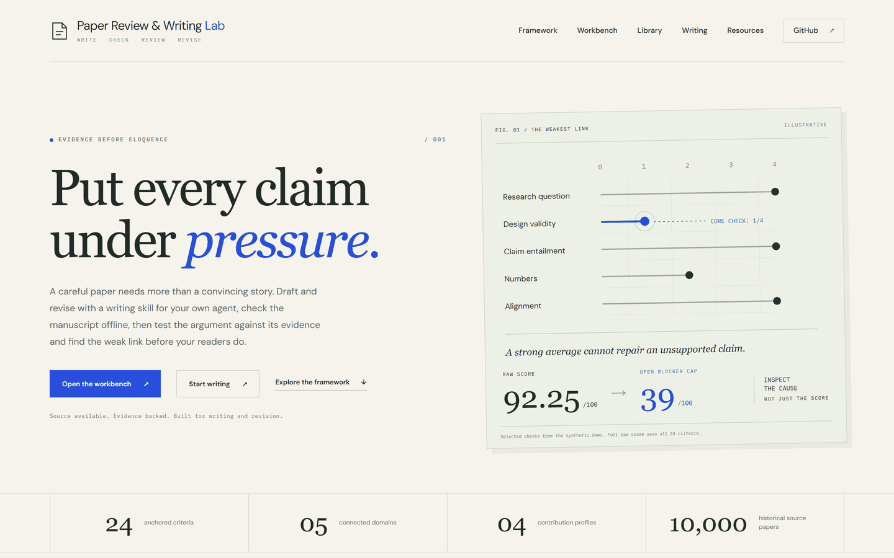
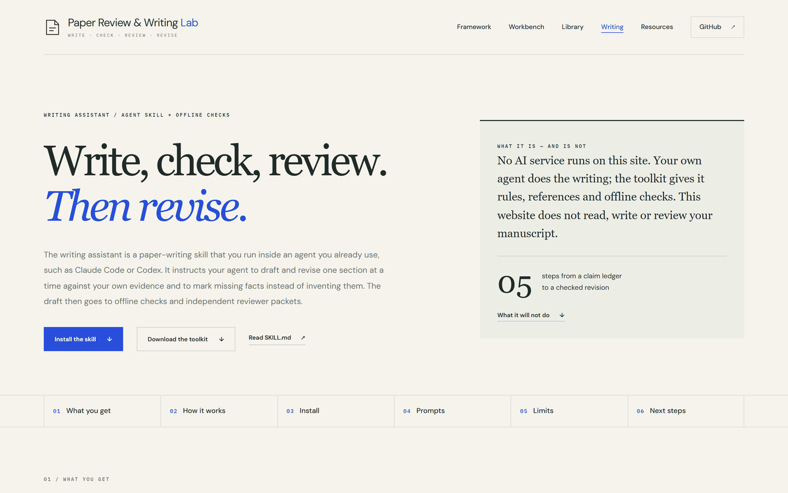
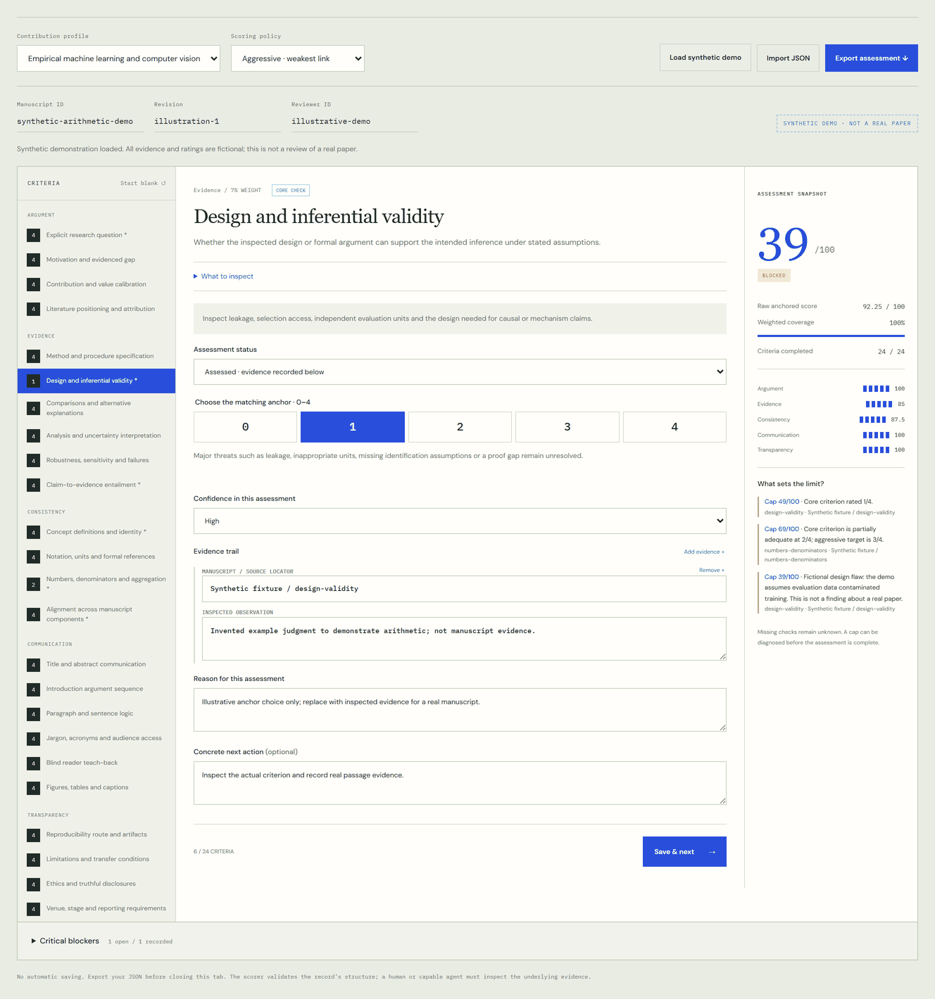
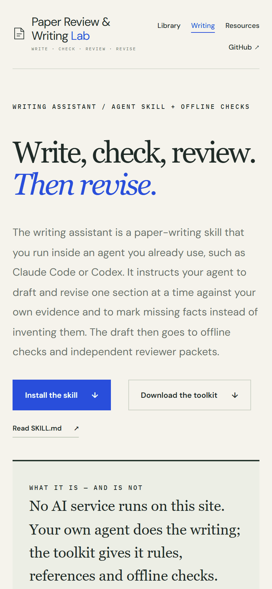
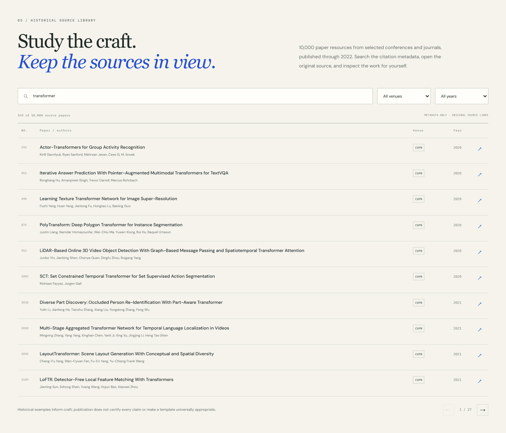
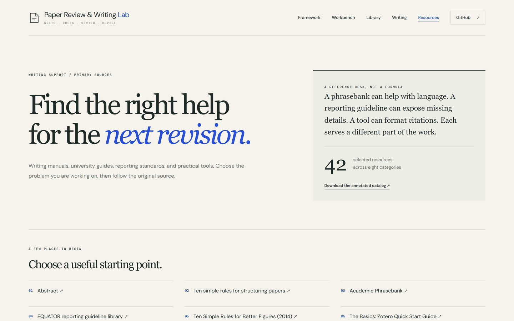

<h1 align="center">
  <picture>
    <source media="(prefers-color-scheme: dark)" srcset=".github/assets/banner-dark.svg">
    
  </picture>
</h1>

<p align="center">
  <a href="https://optimizer077.github.io/paper-review-lab/"></a>
  
  <a href="#verification"></a>
  <a href="#verification"></a>
  
  <a href="#evidence-and-scope"></a>
</p>

<p align="center">
  <a href="https://optimizer077.github.io/paper-review-lab/"><b>Live site</b></a> ·
  <a href="https://optimizer077.github.io/paper-review-lab/#workbench">Review workbench</a> ·
  <a href="https://optimizer077.github.io/paper-review-lab/writing.html">Writing assistant</a> ·
  <a href="https://optimizer077.github.io/paper-review-lab/resources.html">Resource hub</a> ·
  <a href="https://optimizer077.github.io/paper-review-lab/downloads/paper-review-lab.zip">Toolkit download (.zip)</a> ·
  <a href="toolkit/paper-writing/SKILL.md">SKILL.md</a> ·
  <a href="toolkit/README.md">Toolkit guide</a>
</p>

An evidence-first lab for writing and reviewing scientific manuscripts in ML, computer vision and health research. Draft and revise with the **paper-writing skill** inside an agent you already run, such as Claude Code or Codex. Check the draft with an **offline Python harness**, hand out **independent reviewer packets**, and score an inspected revision against **24 anchored criteria** in a local browser workbench. Make the reasoning inspectable, record what remains unknown, and revise the weakest part of the argument.

> [!IMPORTANT]
> **No AI backend.** The website does not read manuscripts or call an AI service, and the core command-line tools run offline and dispatch no agents. The writing assistant is a skill that runs inside an agent you operate. That agent sends the manuscript text it reads to the model service it is configured to use, under that service's terms; the website and the harness send nothing. Do not give an agent a confidential submission you were assigned to review unless the venue's policy allows it (see [venue notes](toolkit/paper-writing/references/venue-profiles.md)). A person or capable agent must inspect the manuscript and its evidence. Generated packets are review tasks; they are not completed reviews. Browser entries remain in the tab, with no automatic saving, so export your JSON before closing it.

## What you can do

<picture>
  <source media="(prefers-color-scheme: dark)" srcset=".github/assets/capabilities-dark.svg">
  
</picture>

| Goal | Tool | Where it runs | Start here |
| --- | --- | --- | --- |
| **Write**: draft or revise one section at a time, tie claims to evidence, and mark gaps instead of filling them | paper-writing agent skill | Inside an agent you operate, such as Claude Code or Codex | [SKILL.md](toolkit/paper-writing/SKILL.md) · [Writing page](https://optimizer077.github.io/paper-review-lab/writing.html) |
| **Check**: missing sections, word limits, prohibited wording, unregistered citations, locked-number mismatches, disallowed variants, placeholders, undefined acronyms | `paper_harness.py audit` and `packet` | Your machine; Python standard library only | [Harness guide](toolkit/paper-writing/references/harness-guide.md) |
| **Review**: ten reviewer-role packets, blind reader first; returned reports are merged and checked against the plan's hashes | `paper_harness.py plan` and `merge` | Your machine; dispatches no agents and calls no model | [Review protocol](toolkit/paper-writing/references/review-protocol.md) |
| **Score**: 24 anchored criteria, raw and capped scores, coverage, blockers and readiness | Browser workbench and `score_evaluation.py` | Your browser tab, or your machine | [Workbench](https://optimizer077.github.io/paper-review-lab/#workbench) · [Scorecard](toolkit/paper-writing/references/evaluation-scorecard.md) |
| **Learn**: 42 primary-source writing resources by task, and 10,000 citation-metadata records from 2018–2022 | Resource hub and paper library | Your browser; the pages filter links only | [Resource hub](https://optimizer077.github.io/paper-review-lab/resources.html) · [Library](https://optimizer077.github.io/paper-review-lab/#library) |

## How the loop works

<picture>
  <source media="(prefers-color-scheme: dark)" srcset=".github/assets/workflow-dark.svg">
  
</picture>

1. **Plan the context.** Copy [`project-template.json`](toolkit/paper-writing/assets/project-template.json) next to your manuscript. Record the thesis, terminology, locked facts, sources, claims (supported, pending or unsupported) and sections. You approve the claim statuses. A "supported" status is your declaration: nothing checks that the source exists or supports the claim. See the [fictional worked example](toolkit/examples/project.json).
2. **Draft or revise one section at a time** with the skill. The skill tells the agent to mark missing facts `[UNRESOLVED: …]` or `[CITATION NEEDED]` instead of filling them in, and the audit flags any markers left in the draft.
3. **Audit.** Exit code 0 means no errors (warnings are possible), 1 means errors, and 2 means invalid input. A pass covers mechanical checks only.
4. **Review.** `plan` writes ten isolated role packets: argument, abstract and introduction, methods, references, evidence, terminology, readability, figures, limitations and venue. The blind reader saves a teach-back before it opens the comparison context. `merge` rejects stale hashes, missing roles and a pass with open findings.
5. **Score if you need a number, then revise.** Fix blockers first, then ambiguity, then prose. After editing, rerun the audit and make a new plan; the new hashes invalidate old reviews.

<details>
<summary><b>Commands for each step on your own paper</b></summary>

Run from the repository root. `my-paper/` stands for your own folder. If you installed only the skill, replace `toolkit/paper-writing` with the installed folder.

```sh
# 1. Plan the context
mkdir -p my-paper
cp toolkit/paper-writing/assets/project-template.json my-paper/project.json

# 3. Audit; optionally build one section's packet (--section takes a section id from project.json)
python toolkit/paper-writing/scripts/paper_harness.py audit my-paper/manuscript.md --context my-paper/project.json --out my-paper/audit.json
python toolkit/paper-writing/scripts/paper_harness.py packet my-paper/manuscript.md --context my-paper/project.json --section results --max-chars 12000 --out my-paper/results-packet.json

# 4. Reviewer packets, then merge the returned reports (in PowerShell, list each file)
python toolkit/paper-writing/scripts/paper_harness.py plan my-paper/manuscript.md --context my-paper/project.json --out my-paper/review-plan.json
python toolkit/paper-writing/scripts/paper_harness.py merge my-paper/review-plan.json my-paper/reviews/*.json --out my-paper/merged.json

# 5. Optional score
python toolkit/paper-writing/scripts/score_evaluation.py my-paper/assessment.json --rubric toolkit/paper-writing/assets/manuscript-rubric.json --strictness aggressive --out my-paper/score.json --markdown my-paper/score.md
```

Track findings in the [revision ledger template](toolkit/paper-writing/assets/revision-ledger-template.json). No script reads or closes it for you.

</details>

## Screenshots

<table>
  <tr>
    <td width="50%" valign="top">
      
      <br><b>Home.</b> The framework and the weakest-link idea. The chart uses the fictional demo.
    </td>
    <td width="50%" valign="top">
      
      <br><b>Writing assistant.</b> How to use the skill with your own agent, with tested commands and copy-paste prompts.
    </td>
  </tr>
  <tr>
    <td width="50%" valign="top">
      
      <br><b>Review workbench.</b> The synthetic demo: raw 92.25, capped at 39 by an open blocker. All ratings are fictional.
    </td>
    <td width="50%" valign="top" align="center">
      
      <br><b>On a phone.</b> The writing page at 390 px wide.
    </td>
  </tr>
  <tr>
    <td width="50%" valign="top">
      
      <br><b>Citation library.</b> Search 10,000 metadata records; each row links to the original source.
    </td>
    <td width="50%" valign="top">
      
      <br><b>Resource hub.</b> 42 primary-source resources; search, or filter by category, type and contribution profile.
    </td>
  </tr>
</table>

## Use the writing assistant with your agent

The full guide, with copy buttons, is the [Writing assistant page](https://optimizer077.github.io/paper-review-lab/writing.html).

**1. Get the skill folder.** Clone the repository or unzip the [toolkit download](https://optimizer077.github.io/paper-review-lab/downloads/paper-review-lab.zip). The skill folder is `toolkit/paper-writing` in a clone and `paper-review-lab/paper-writing` in the zip. Copy the whole folder: `SKILL.md` links to its `references/`, `assets/` and `scripts/` folders.

**2. Install it where your agent looks for skills.**

| Agent | All projects | One project | Ask with |
| --- | --- | --- | --- |
| [Claude Code](https://code.claude.com/docs/en/skills) | `~/.claude/skills/paper-writing` | `.claude/skills/paper-writing` | "Use the paper-writing skill to …" |
| [Codex](https://developers.openai.com/codex/skills) | `~/.agents/skills/paper-writing` | `.agents/skills/paper-writing` | `$paper-writing …` |

```sh
git clone https://github.com/Optimizer077/paper-review-lab.git
cd paper-review-lab

# Claude Code. For Codex, write ~/.agents in place of ~/.claude.
# Upgrading? Delete the old ~/.claude/skills/paper-writing folder first.
mkdir -p ~/.claude/skills
cp -R toolkit/paper-writing ~/.claude/skills/
python ~/.claude/skills/paper-writing/scripts/paper_harness.py --help
```

<details>
<summary>Windows PowerShell</summary>

```powershell
# Claude Code. For Codex, write .agents in place of .claude.
New-Item -ItemType Directory -Force "$HOME\.claude\skills" | Out-Null
Copy-Item -Recurse toolkit\paper-writing "$HOME\.claude\skills\"
python "$HOME\.claude\skills\paper-writing\scripts\paper_harness.py" --help
```

</details>

**3. Check the install.** Start a new agent session and ask it to list its available skills; `paper-writing` should appear. For Codex, `agents/openai.yaml` supplies the display name "Scientific Paper Writing". Use `python3` where `python` is not on your PATH. Skill locations can change between agent versions, so check your agent's skill documentation if the skill does not appear.

The harness and scorer need only Python 3.10+ and the standard library; nothing is installed from pip. The fictional examples in `toolkit/examples/` and the citation library in `toolkit/research/` sit outside the skill folder. Writing does not depend on them. The links from `references/research-basis.md` into the citation library work in a clone or the unzipped toolkit download (`paper-review-lab/research/` in the zip), but not in a skill folder copied on its own, for example into `~/.claude/skills`.

**4. Ask for the work.** Three of the six prompts are below. Replace the `[BRACKETED]` slots and `<skill-dir>` (your installed folder, for example `~/.claude/skills/paper-writing`). `my-paper/` stands for your folder with `manuscript.md` and `project.json`.

<details open>
<summary><b>Revise an abstract against the evidence</b></summary>

```text
Use the paper-writing skill. Revise the abstract of my-paper/manuscript.md for
[VENUE, YEAR, TRACK]. The project context is my-paper/project.json.

Keep every number, comparator, metric direction, unit, denominator and uncertainty
exactly as reported in the Results section and in locked_facts. Do not add results,
citations, datasets or claims that are not already in the manuscript. If a needed
fact is missing, write [UNRESOLVED: what is missing] instead of filling it in.

Return: (1) the revised abstract; (2) a table mapping each sentence to its supporting
manuscript location or claim ID; (3) every statement you weakened or removed, and why.

Then run
`python <skill-dir>/scripts/paper_harness.py audit my-paper/manuscript.md --context my-paper/project.json`
and report its findings as printed. Do not describe a clean audit as proof that the
abstract is correct.
```

</details>

<details>
<summary><b>Claim-to-evidence check</b></summary>

```text
Use the paper-writing skill and its evidence-review reference. For each central claim
in the title, abstract, contribution list and conclusion of my-paper/manuscript.md,
build a table with these columns: exact claim text and location; claim type
(observation, mechanism, formal guarantee, association, causal); comparator; metric
and direction; denominator or independent unit; uncertainty as reported; supporting
table, figure or theorem; status (supported by a passage I inspected / needs evidence
/ overstated / contradicted).

Cite only evidence you actually read in the manuscript or the files I supplied; write
"not inspected" otherwise. List blockers first. For overstated claims, propose the
narrowest wording the evidence supports. Do not change numbers and do not propose
analyses as if they had been done.
```

</details>

<details>
<summary><b>Point-by-point reviewer response</b></summary>

```text
Use the paper-writing skill. Inputs: reviewer comments in
my-paper/reviewer-comments.txt, the revised manuscript my-paper/manuscript.md, and my
notes on what changed in my-paper/changes.md.

Draft a point-by-point response. Split multi-part comments. For each point give a
direct answer, then either the actual change with its verified location in the revised
file or a reasoned disagreement. Label each item: clarified / new analysis completed /
proposed, not done / disagree.

Do not claim any experiment, number, page, line or change that is not in the revised
file or my notes; mark gaps [UNRESOLVED]. Finally, check that the abstract and
conclusion still match the revised results, and list any mismatch.
```

</details>

The other three prompts are on the [Writing page](https://optimizer077.github.io/paper-review-lab/writing.html#prompts): tighten an introduction without losing its logic, a terminology and acronym consistency pass, and a blind-reader teach-back with the harness packets.

## Quick start

Use Python 3.10+ from the repository root. The site requires HTTP so its local JSON files can load:

```sh
python -m http.server 8765 --directory docs
```

Open `http://localhost:8765` (the writing page is `http://localhost:8765/writing.html`). No package installation or build step is required.

Audit the bundled fictional manuscript or prepare reviewer packets:

```sh
python toolkit/paper-writing/scripts/paper_harness.py audit toolkit/examples/manuscript.md --context toolkit/examples/project.json --out audit.json
python toolkit/paper-writing/scripts/paper_harness.py plan toolkit/examples/manuscript.md --context toolkit/examples/project.json --out review-plan.json
```

The audit exits 0 with status `pass` on this fixture. `plan` writes `review-plan.json` and a `review-plan.packets/` folder with ten role packets and `comparison-context.json`.

Export an assessment from the workbench, then score it locally:

```sh
python toolkit/paper-writing/scripts/score_evaluation.py assessment.json --rubric toolkit/paper-writing/assets/manuscript-rubric.json --strictness aggressive --out scored.json --markdown review.md
```

To try the scorer without an export, pass the fictional demo `docs/data/demo-assessment.json` in place of `assessment.json`. It reports raw 92.25, effective 39 and readiness `blocked`.

See the [harness guide](toolkit/paper-writing/references/harness-guide.md) and [scorecard](toolkit/paper-writing/references/evaluation-scorecard.md) for inputs, commands and interpretation.

## Review workbench and scoring

- **24 anchored criteria across five domains** (argument 4, evidence 6, consistency 4, communication 6, transparency 4), adapted to four contribution profiles: empirical ML, theory, clinical research and systematic reviews. Six core checks protect the argument's foundations; they cannot be marked not applicable. See the [rubric JSON](toolkit/paper-writing/assets/manuscript-rubric.json).
- **Anchored ratings** run from 0 (observed fundamental defect) to 4 (strong support in the inspected scope). Unassessed means unknown, never zero.
- **Transparent scoring** with evidence, rationale, coverage, confidence, domain results and critical blockers. Aggressive mode, the workbench default, preserves the raw score and applies the lowest triggered score cap: effective score = min(raw score, all applicable caps). Penalties are never added together. A total appears only when every criterion is assessed or validly excluded. Standard mode retains the raw weighted score and baseline core readiness checks.
- **A local browser workbench** for manual assessment, JSON import/export, rubric exploration, and a searchable library of **10,000 citation metadata records from 2018–2022**.
- **A Python toolkit** for mechanical manuscript audits, versioned scorecards, and task packets for **ten independent reviewer roles**.

<details>
<summary>Aggressive-mode score caps</summary>

| Recorded condition | Score ceiling |
| --- | --- |
| Open critical blocker | 39 |
| Core criterion rated 0 or 1 | 49 |
| Core rating 2, or any other criterion rated 0 or 1 | 69 |
| Complete domain below 60 / below 75 | 59 / 74 |
| Core confidence low / medium | 59 / 79 |

In the fictional demo, one open critical blocker caps a full 24-criterion raw score of 92.25 at 39. Caps and thresholds are defined in [`scoring-policies.json`](toolkit/paper-writing/assets/scoring-policies.json) and explained in [`aggressive-review.md`](toolkit/paper-writing/references/aggressive-review.md).

</details>

"Reviewed" describes a completed assessment. It is not submission approval, scientific certification, or an acceptance forecast.

## Writing-support hub

[Explore the resource hub](https://optimizer077.github.io/paper-review-lab/resources.html) · [Task-by-task guide](toolkit/paper-writing/references/writing-support-guide.md) · [Annotated catalog](toolkit/paper-writing/references/writing-resources.md)

The support catalog contains **42 selected primary-source resources across eight categories**: planning, sections, clarity, reporting, displays, citations/integrity, review/submission and tools. It includes MIT guides, the Manchester Phrasebank, writing manuals, Duke, Stanford and Nature courses, study-design reporting standards, and documented reference and document tools. Each entry explains how to use it and records its source, access, inspection level and limits. Book metadata, indexed excerpts, course descriptions and tool documentation are distinguished from full reading, course completion or independent testing. The hub page filters links; it does not read or edit manuscripts.

Support resources are maintained separately from the 10,000-paper historical index and can include current guidance published after 2022, such as CONSORT 2025 and TRIPOD+AI (2024).

## Repository layout

```text
paper-review-lab/
├── docs/                        GitHub Pages site (buildless, served from main:/docs)
│   ├── index.html               framework, review workbench, 10,000-record library
│   ├── writing.html             writing assistant guide (static; no backend)
│   ├── resources.html           writing-support hub
│   ├── scoring-engine.js        browser scorer, checked against the Python scorer
│   ├── data/                    rubric, policies, fictional demo, corpus, resource catalog
│   └── downloads/               paper-review-lab.zip (the toolkit download)
├── toolkit/
│   ├── paper-writing/           the agent skill: SKILL.md, references/, assets/, scripts/
│   ├── examples/                fictional manuscript and project context
│   ├── research/                citation registries and inspection notes
│   └── validation/              portable test suite
├── tests/check_site_parity.py   browser vs Python scoring parity
└── .github/assets/              README banner, diagrams and screenshots
```

## Verification

```sh
python -m unittest discover -s toolkit/validation -p 'test_*.py' -q
python tests/check_site_parity.py
python toolkit/paper-writing/scripts/validate_writing_resources.py toolkit/paper-writing/references/writing-resources.json
```

| Check | Result |
| --- | --- |
| Portable toolkit tests | 123 run: 122 pass and one local-cache-only check is skipped (the raw source caches are not part of this export) |
| Browser parity, Python scorer vs `docs/scoring-engine.js` | 176 fictional scenarios (4 integer-weight profiles × 2 modes × 22 scenarios), 0 mismatches |
| Resource catalog validator | `status: valid`, 42 resources, 8 categories |
| Quick-start commands above | audit exit 0 (`pass`, 0 errors, 0 warnings); plan exit 0 (10 role packets plus comparison context); demo score raw 92.25, effective 39, `blocked` |

The parity check requires Node.js 20+ alongside Python 3.10+. Parity covers scores, domain results, coverage, readiness, caps, and rubric/policy fingerprints. Domain thresholds use unrounded ratios; displayed scores use two-decimal rounding. Custom floating-point rubric serialization is outside this compatibility claim.

These results come from a local run on Python 3.13 and Node.js 24; the toolkit tests and parity check also pass on Python 3.11. The stated minimums, Python 3.10 and Node.js 20, were checked by reviewing syntax and APIs, not by running those versions. The repository has no CI workflow, so the badges above record this local run.

## Evidence and scope

**Writing assistant.** The skill tells an agent not to invent results, methods, datasets, citations, approvals or completed revisions, and to mark missing facts instead. The harness does not verify that a citation exists, that a source supports a claim, or that the paper is readable. A passing audit is a prompt for inspection, not proof of correctness. The harness cannot prove that the blind reading order was followed, and ten generated packets are not ten completed reviews. The skill is not a tool for disguising AI-assisted text or replacing a venue's AI-use rules. The skill is written for ML, computer vision and health research; its venue notes and historical examples cover only those fields. The venue notes are a dated snapshot; check the current instructions for your cycle and track.

**Library.** The historical library hosts citation metadata and original editorial notes; it does not distribute abstracts or article bodies. The original local collection contained 300 abstracts and 238 downloaded bodies; neither is hosted here. Collection, selected-section inspection, and full scientific review are distinct: eighteen selected papers were inspected at abstract or selected-section level. These selected venues and papers are neither an objective venue ranking nor a representative sample. Bundled manuscript fixtures and demonstration assessments contain fictional data; the citation registry identifies actual historical papers.

The expanded [10,000-record registry](toolkit/research/library-10000/papers.jsonl), [venue/year counts](toolkit/research/library-10000/summary.json) and [collection report](toolkit/research/library-10000/collection-report.md) document 9,000 conference papers and 1,000 journal papers, including all 300 initial citation IDs. Metadata collection adds no new semantic-reading or scientific-review claims.

**Scores.** Scoring thresholds are editorial conventions without prospective real-manuscript calibration. A score, audit pass, or completed assessment does not certify scientific validity, establish submission readiness, or predict acceptance.

**Hosting.** GitHub Pages serves the buildless site from `main:/docs`. The site loads no external scripts. Its only external resources are Google Fonts: the stylesheet that `site.css` imports from fonts.googleapis.com and the DM Sans and IBM Plex Mono font files it loads from fonts.gstatic.com. Without them the pages fall back to Arial or the system sans-serif, and Consolas or the system monospace. See [site maintenance and provenance](docs/README.md) for deployment details.

## License

No license file is published yet, so default copyright applies (all rights reserved). Ask the repository owner before reusing the code or text. Linked third-party guides, standards and papers keep their own terms.
